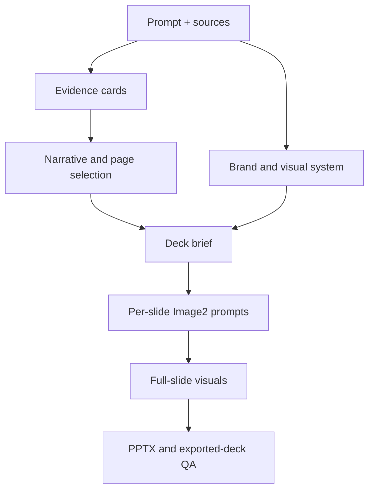

# BP to Image2 Pitch Deck

**New: [Noir PPT Studio](NOIR_STUDIO.md)** — a photographic editorial Skill with native editable text/shapes, per-slide SVG, a bundled converter, and one-command installation/generation. [中文一键使用说明](NOIR_STUDIO.md).

```bash
python -m pip install -r requirements-noir.txt
python tools/noir.py install
python tools/noir.py generate --brief my-brief.md --job ../my-deck
```

Windows: double-click `install-noir.cmd` once, then drag a brief onto `start-noir.cmd`. The installed Codex runtime performs research and creative work with the tools actually available to the account. The deterministic exporter itself does not generate images. Public assets are methods and synthetic examples, not private company decks or campaign photographs.

The original visual-first workflow below is retained. The new Noir route adds native editable PPTX + SVG and respects a different user-selected reference.

[中文说明](README.zh-CN.md)

An installable Codex skill that turns a user prompt, company information, and mixed reference material into an evidence-controlled, high-end pitch deck designed with Image2.

Inputs can be sparse. A BP and visual references are optional. The workflow selects only the pages supported by the objective and evidence, derives a company-specific brand system, creates a high-complexity production prompt for every slide, generates full-slide visuals, assembles the PPTX, and validates the exported deck.

## Teammate handoff kit

The `team-kit/` directory contains a machine-readable Codex entry prompt, a safe cross-platform installer, an input template, and package verification tooling. Build a self-contained ZIP with:

```bash
python team-kit/build_team_package.py --out ../Image2投行PPT_Codex使用包.zip
```

## This is the creation workflow

This repository creates a **new** deck from source material. It is deliberately separate from [`editable-ppt-image2-rebuild`](https://github.com/wangqi045788-byte/editable-ppt-image2-rebuild), which reconstructs an existing slide or screenshot as editable PowerPoint objects.

| Project | Starts from | Primary output | Editability |
| --- | --- | --- | --- |
| `bp-to-image2-pitch-deck` | Prompt, company information, reference material, optional BP, optional visual references | Newly selected narrative and Image2-designed pitch deck | Full-slide visual renders |
| `editable-ppt-image2-rebuild` | Existing slide image, PDF page, or screenshot | High-fidelity reconstruction | Semantic editable objects |

## Input contract

- **Required:** user prompt and at least one usable company/reference source.
- **Optional:** BP, draft deck, logo, brand guide, product images, screenshots, report excerpts, and visual references.
- **Flexible:** exact slide count, range, or automatic selection.

The skill does not force a standard fifteen-page template. It can produce a one-page product study, a concise management roadshow, or a full investor deck depending on the prompt and available evidence.

## Workflow



Core rules:

- no invented facts, metrics, customers, interfaces, or citations;
- reported facts, calculations, user assertions, and analyst judgment stay distinct;
- supplied logos and factual images are preserved exactly;
- company-specific visual language replaces generic technology templates;
- one clear reading path, controlled copyfit, and deliberate hierarchy per slide;
- private work stays outside the repository;
- public examples are synthetic or independently public and rights-reviewed.

## Install

Clone or copy the repository into your Codex skills directory, then invoke:

```text
$bp-to-image2-pitch-deck
```

Example request:

```text
Use $bp-to-image2-pitch-deck to create an investor pitch from my prompt,
company information, and reference files. The BP and visual references are
optional. Select the strongest evidence-supported pages and use Image2 for the
designed slide visuals.
```

## Deterministic helpers

Initialize a private job directory outside the repository:

```bash
python scripts/init_job.py /path/to/private-job --title "Company pitch"
```

Validate a planned deck:

```bash
python scripts/validate_deck_brief.py /path/to/deck-brief.json
```

Build the prompt pack:

```bash
python scripts/prepare_generation.py /path/to/deck-brief.json \
  --out /path/to/prompt-pack.md
```

Run the public-release scanner with a private denylist stored outside the repository:

```bash
python scripts/public_release_check.py . --denylist /path/to/private-denylist.txt
```

## Public demo

The included HelioGrid demo is fictional. It demonstrates slide selection, evidence typing, copyfit, brand direction, and deterministic prompt generation without using a real company or client asset.

```bash
python scripts/validate_deck_brief.py examples/public-demo/deck-brief.json
python scripts/build_prompt_pack.py examples/public-demo/deck-brief.json \
  --out examples/public-demo/prompt-pack.public.md
```

## Validation

```bash
python -m unittest discover -s tests -v
python scripts/public_release_check.py . --skip-history
```

Automated checks do not replace manual privacy, ownership, brand-rights, or third-party-license review.

## License

MIT. Do not assume that user inputs, company assets, third-party materials, or generated outputs inherit this repository's license.
